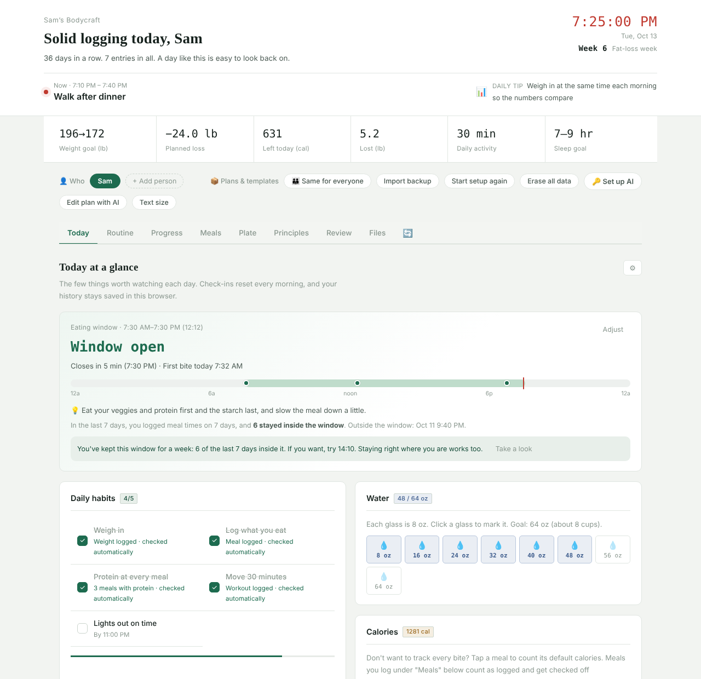
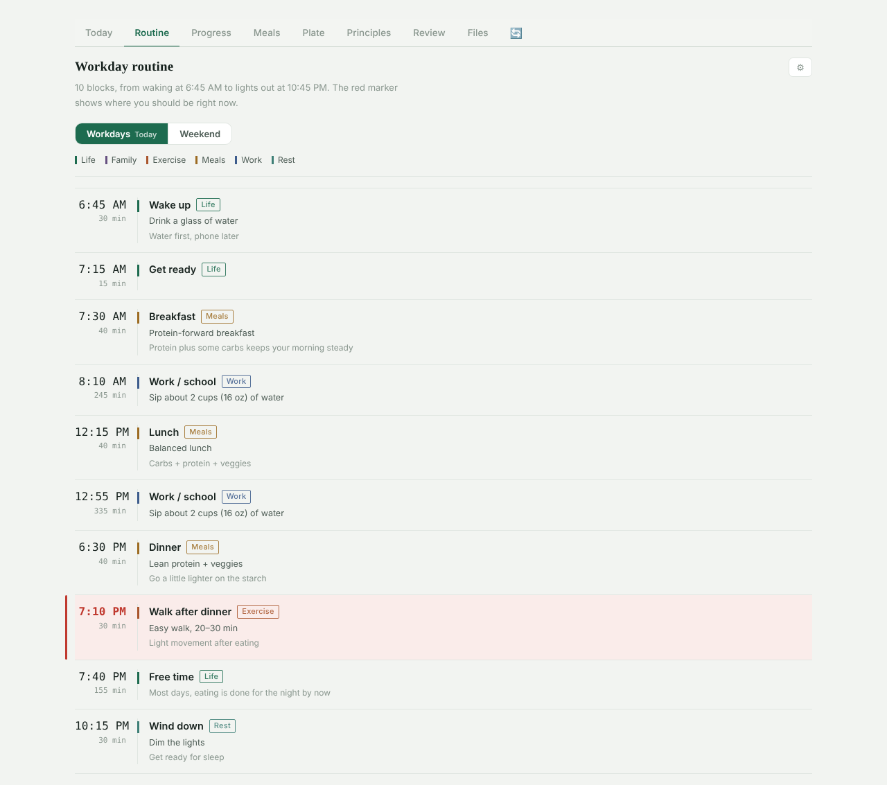
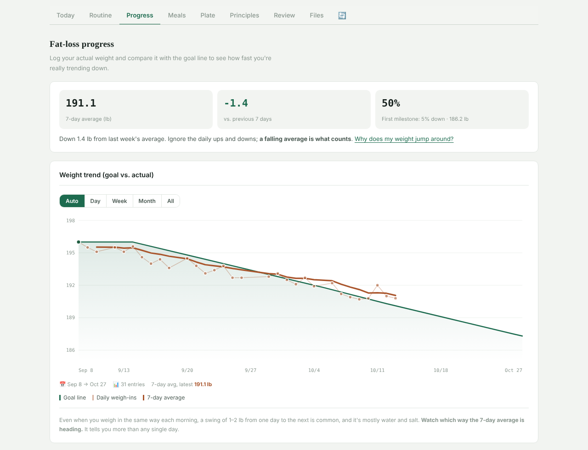
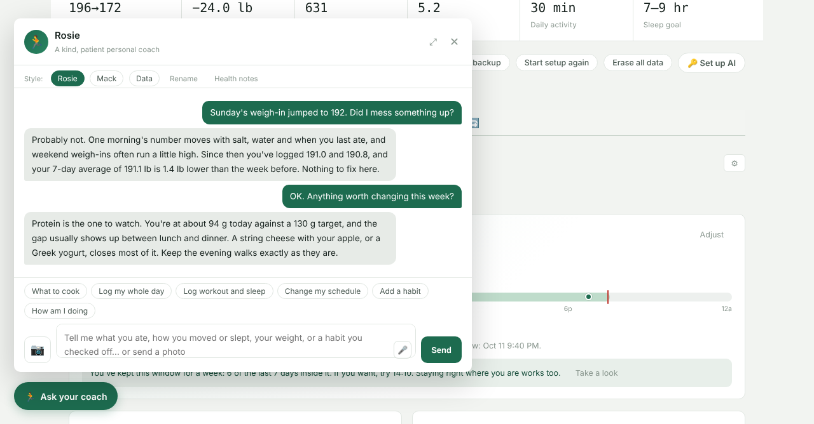
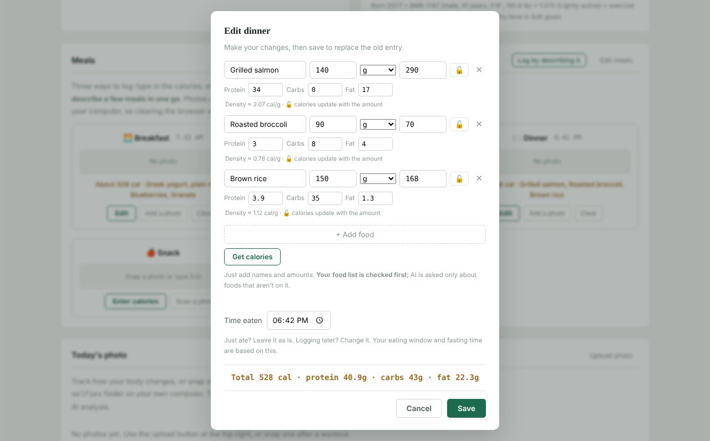

# Bodycraft

**A private fat-loss companion that runs on your own computer.** Plan your day, log meals, workouts, sleep and weigh-ins, and talk it through with an AI coach that knows your numbers. Everything is stored in plain files in one folder. No account, no cloud, no subscription.

> 中文版 / Chinese edition: **[时光雕刻](https://github.com/mmjj324/shiguang-diaoke)** — the original app Bodycraft was forked from.



## What it does

- **A daily rhythm you can see.** A timeline of your day (wake-up, meals, walks, wind-down), with a marker showing where you should be right now. Workday and weekend versions, shift-work aware.
- **Logging that takes seconds.** Type "oatmeal and coffee for breakfast, walked 30 min, 182.4 lb" and Bodycraft sorts it into meals, workouts, sleep and weight. Or snap a photo of your plate. Or log by hand without any AI at all.
- **Protein, carbs and fat, not just calories.** About 75 common US foods are built in with per-serving macros (each, slice, cup, oz, tbsp, scoop…). Foods you look up once are remembered.
- **Honest progress.** Weight is shown as 7-day averages next to a goal line, because single weigh-ins swing by a pound or two. Pace is checked against the CDC's 1–2 lb a week; goals below a healthy BMI are refused.
- **A coach with three voices.** Rosie (warm), Mack (tough love) and Data (just the numbers). The coach sees your plan, recent weigh-ins, meals, eating window and your own notes, so its answers are about you.
- **Optional 16:8.** An eating-window card that starts gently (12:12) and never pushes.
- **Households.** Several people on one computer, each with their own body, plan and history.
- **Reviews and sharing.** A written review of any date range, a CSV export (lb and kg), and a share card that never shows your weight unless you choose to.

| Routine | Progress |
|---|---|
|  |  |

| Coach | Meals |
|---|---|
|  |  |

## Quick start

You need **Python 3.9 or newer** (no extra packages) and Chrome, Edge, Brave or Firefox.

1. Download this repository (**Code → Download ZIP**) and unzip it anywhere you like.
2. Start it:
   - **Windows:** double-click `start.py`.
   - **macOS / Linux:** open a terminal in the folder and run `python3 start.py`.
3. The app opens in its own window. Answer the one-minute setup (pounds or kilograms, height, goal) and you're in.

Optional: `python3 install.py` adds a desktop shortcut and can start Bodycraft when you log in (Windows, macOS and Linux). `python3 uninstall.py` removes exactly what it added and keeps your data.

The full guide, with screenshots and troubleshooting, is in **[USER_GUIDE.html](USER_GUIDE.html)** (download the repo and open it in your browser).

## AI is optional

Manual logging, the routine, habits, water, charts, reviews of your own numbers and the food list all work with no AI.

To turn on the coach, free-text logging and photo reading, click **🔑 Set up AI** and pick a provider:

| Provider | Notes |
|---|---|
| OpenAI | Default. Key from platform.openai.com |
| Anthropic Claude | Uses Anthropic's OpenAI-compatible endpoint. Key from console.anthropic.com |
| Google Gemini | Key from aistudio.google.com |
| OpenRouter | One key, many models |
| Ollama | Runs on your own computer. No key, nothing leaves your machine |
| Custom | Any OpenAI-compatible endpoint |

Usage is billed by your provider to your own account. Bodycraft picks a small, fast model for structured work like parsing meals, and your main model for conversation; you can override both.

## Your data stays yours

- The server listens on `127.0.0.1` only and refuses requests from other sites in your browser.
- Your records live as JSON files in the app folder (`data.json`, `content.json`, `photos/`, …). Back up the folder and you've backed up everything; a rolling copy is also kept in `backups/`.
- The only thing that ever leaves your computer is an AI request, sent to the provider you chose, and only when you use an AI feature.
- `.gitignore` excludes every personal file, so a fork or pull request can't leak them.

## Upgrading

Unzip the new version over the old folder and start it again. Your data files aren't part of the download, so they stay put; `start.py` notices the old server and restarts it on the new version.

## How Bodycraft differs from 时光雕刻

Bodycraft isn't a translation. It started from the same code and was rebuilt for US and Western users:

- Pounds by default (kg one click away), height in feet and inches, water in ounces and cups, 12-hour time, US dates.
- A US food database with per-serving units, and Western default menus, plates and habits.
- WHO BMI bands (25/30) instead of China's (24/28); CDC and Diabetes Prevention Program references.
- A Western daily rhythm with no midday nap block, dinner around 6:30.
- English intent detection, coach personas and prompts written natively, and a choice of AI providers in place of the Chinese ones.

## Tests

```
python3 tests/run_tests.py          # all 13 layers
python3 tests/run_tests.py fast     # the ones that don't need a browser (seconds)
```

The browser layers use Playwright (`pip install playwright && playwright install chromium`).

## Health disclaimer

Bodycraft is a personal tracking and reminder tool. Its routines, meal ideas, calorie numbers, goal weights and AI feedback are general information, not medical, nutrition or fitness advice. Photo calorie estimates can be far off. If you have a health condition, take medication, are pregnant or breastfeeding, are under 18, or feel anxiety or a loss of control around food or weight, please talk with a health professional before using the plan features.

## License

[PolyForm Noncommercial 1.0.0](LICENSE). Free for personal, family, educational and nonprofit use; commercial use isn't permitted. © 2026 @mmjj324
